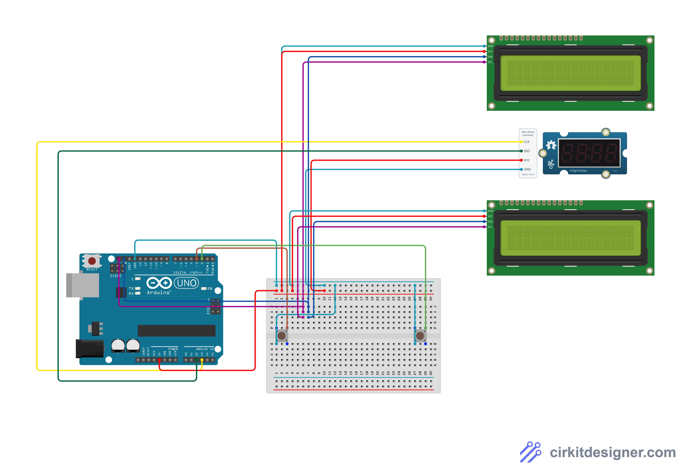

# Projekti dokumentatsioon

## 1. Projekti eesmärk ja seadme lühikirjeldus
**Mis asi see on, mida ja miks me teeme? Millist praktilist probleemi see lahendab?**

- Minu projekti eesmärk oli luua kaasaskantev blackjacki mängumasin
- Ehitasin sellise masina kuna mulle väga meeldiv blackjacki mangida
- Peamine probleem mida see lahendab on igavus
- Peamised komponendid: Arduino mikrokontroller, 2 LCD ekraani, 1 nelja kohaline TM1637 ekraain ja 2 nuppu

---

## 2. Sisendite loetelu
**Millised on süsteemi poolt loetavad / mõõdetavad sisendid? Millega neid mõõdetakse / tuvastatakse?**

- Nupp "hit" ehk, vasakpoolne nupp mängu sees võtab kaarte juurde
- Nupp "hit" mängust väljas läheb järgmisele lehele (kui mäng läbi saab saab minna 'hit' nupuga edasi)
- Nupp "stand" ehk, parempoolne nupp mängu sees lõpetab mängija kaartide võtmise
- Nupp "stand" mängust väljas valib rastustaset (easy, normal, hard)

---

## 3. Väljundite loetelu
**Mida süsteem teeb / muudab? Millega väljund realiseeritakse?**

- Mängija võtab kaarte juurde → LCD ekraan
- Mängija kaotab/võidab → LCD ekraan
- Diiler võtab kaarte juurde → LCD ekraan
- Diiler kaotab/võidab → LCD ekraan
- Mängija võidab/kaotab → TM1637

---

## 4. Nõuded loodavale seadmele
**Mis peab toimuma, kui kasutaja teeb mingi toimingu? Kirjelda käitumisloogika.**

- Kui vajutatakse "hit" nuppu, vasak poolset nuppu, siis:
  - kui on mängus sees, siis antakse mängijale kaart juurde
  - kui ei ole mängus sees, siis alustatab algmenüüst mängu või peale mängu läbi saamist saab sama raskusatmega edasi mängida

- Kui vajutatakse "stand" nuppu, parem poolset nuppu:
  - kui on mängus sees, siis lõpetatakse kaartide juurde võtmine
  - Kui ei ole mängus sees, siis vahetatakse raskusastmete vahel või minnakse peale mängu läbi saamist raskusatme valimise menüsse

👉 _Pane siia KÕIK kokkulepitud reeglid. Need reeglid on alus, mille järgi hiljem hinnatakse, kas teie lahendus vastab eesmärgile._

---

## 5. Süsteemi füüsiliste komponentide loetelu
**Millest seade koosneb? Lisa lingid või täpsed nimed, et keegi teine saaks sama asja uuesti osta / teha.**

Tabelina või punktidena. Nt:

- Arduino Uno (mikrokontroller)
- 2 x LCD ekraan + I2C moodul 
- TM1637 moodul
- 2 mikrolülitit, Tactile Push Button Switch
- I2C driver (Wire)
- LCD driver (LiquidCrystal_I2C)
- 4 segmendiga TM1637 driver (TM1637)
- 3D prinditud ümbris
- Toiteallikas:  USB akupank, 5V ~2 A

👉 _Kui ise tegite 3D mudeli, lisage STL või Fusion faili `hardware/` alla. Kui kasutasite netist leitud mudelit, märkige allikas._

---

## 6. Ühendusskeem
**Kuidas kõik osad on omavahel ühendatud?**

- Vooluallikas akupank

---

## 7. Süsteemi juhtiv kood (või pseudokood)
**Kirjelda programmi loogikat nii, et seda on võimalik aru saada ka hiljem.**  
Kui kood töötab, pane siia lühike selgitus + viide failile `src/projektinimi.ino`.  
Kui kood pole veel valmis, lisa siia pseudokood.
